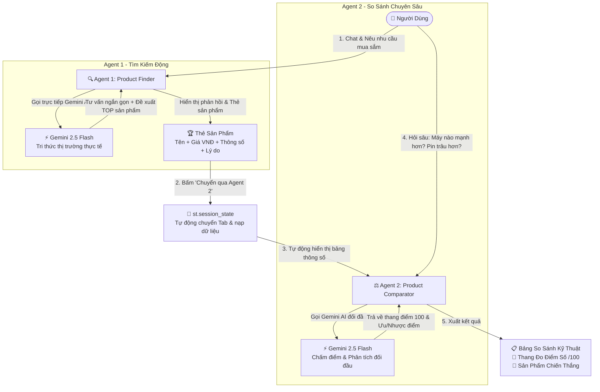

# SmartChoice AI – Trợ Lý Mua Sắm & So Sánh Sản Phẩm Thông Minh (Multi-Agent AI)

> **Ứng dụng:** Trợ lý mua sắm AI cá nhân hóa với 2 Agents độc lập phối hợp trực tiếp:
> - **Agent 1 (Product Finder):** Trò chuyện hỏi đáp tự nhiên, tìm kiếm & đề xuất sản phẩm thực tế trên thị trường bằng 100% tri thức Gemini AI (không fix cứng dữ liệu).
> - **Agent 2 (Product Comparator):** So sánh đối đầu kỹ thuật, chấm điểm thang 100, phân tích ưu/nhược điểm và kết luận sản phẩm đáng mua nhất.
> - **Phong cách trả lời:** Ngắn gọn, súc tích, đi thẳng vào trọng tâm.

---

## 1. Tính Năng Nổi Bật

1. **Không giới hạn dữ liệu (Dynamic Knowledge):**
   - Không bị bó buộc vào bất kỳ file dữ liệu cố định nào.
   - Bạn có thể hỏi bất kỳ sản phẩm nào trên thị trường: Laptop, Điện thoại, Tai nghe, Chuột, Bàn phím cơ, PC, Máy ảnh, v.v.
2. **Chat hỏi đáp tương tác 2 chiều:**
   - Bạn có thể trò chuyện nhiều lượt (multi-turn chat) với Agent 1 để làm rõ nhu cầu trước khi chọn danh sách so sánh.
   - Bạn có thể đặt câu hỏi so sánh chi tiết với Agent 2 (ví dụ: *"Con nào pin trâu hơn?"*, *"Camera con nào chụp đêm đẹp hơn?"*).
3. **Phản hồi ngắn gọn, trúng đích:**
   - AI loại bỏ câu từ chào hỏi rườm rà, tập trung liệt kê gạch đầu dòng thông số kỹ thuật và so sánh hơn kém trực tiếp.
4. **Tự động hóa luồng phối hợp (Multi-Agent State Transfer):**
   - Chỉ với 1 nút bấm `"👉 CHUYỂN CÁC SẢN PHẨM NÀY QUA AGENT 2 ĐỂ SO SÁNH"`, hệ thống tự lưu danh sách và chuyển ngay sang Tab 2.
   - Lập bảng so sánh thông số kỹ thuật đa chiều và hiển thị thanh đo điểm số trực quan.

---

## 2. Sơ Đồ Kiến Trúc Hoạt Động (Mermaid)



---

## 3. Hướng Dẫn Sử Dụng

### Bước 1: Khởi động ứng dụng
```bash
streamlit run app.py
```
Ứng dụng sẽ chạy tại địa chỉ: **`http://localhost:8501`**.

### Bước 2: Trải nghiệm
- **Tab 1:** Nhập bất kỳ câu hỏi nào bạn muốn tìm hiểu (ví dụ: *"Tầm 15 triệu có laptop nào pin trâu học lập trình không?"*). AI sẽ trả lời súc tích và đề xuất 3-4 mẫu máy tối ưu.
- **Chuyển sang Tab 2:** Bấm nút chuyển để Agent 2 lập bảng thông số kỹ thuật và so sánh chi tiết.
- **Hỏi xoáy Agent 2:** Bấm nút hỏi nhanh hoặc gõ câu hỏi cụ thể để xem đánh giá đối đầu và điểm số phù hợp.
